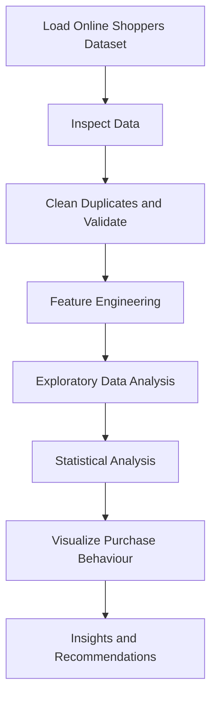

# 🛒 Data-Driven E-Commerce Purchase Intention Analysis Using Python

<p align="center">
  
  
  
  
  
  
</p>

## 📌 Project Overview

This project focuses on analyzing online shoppers' purchasing intentions using Python. It explores customer browsing behaviour, session engagement, product exploration, and purchasing patterns to identify the factors associated with successful e-commerce transactions.

Through Exploratory Data Analysis (EDA), data cleaning, feature engineering, statistical analysis, and visualization, the project transforms raw session-level data into meaningful business insights and actionable recommendations.

## 🎯 Project Objectives

- Understand online shoppers' browsing behaviour using session-level data.
- Analyze administrative, informational, and product-related page visits.
- Examine the relationship between browsing duration and purchasing outcomes.
- Compare purchasing and non-purchasing sessions.
- Evaluate conversion rates across visitor types, months, weekends, traffic types, and regions.
- Identify customer engagement patterns and potential conversion opportunities.
- Develop data-driven business recommendations.

## 📂 Dataset Information

| Attribute | Details |
|---|---|
| Dataset | Online Shoppers Purchasing Intention Dataset |
| Source | UCI Machine Learning Repository |
| Domain | E-Commerce / Retail Analytics |
| Original Records | 12,330 sessions |
| Original Features | 18 columns |
| Target Variable | Revenue |
| Data Type | Numerical, Categorical and Boolean |

**Dataset Sources:**

- [UCI Machine Learning Repository](https://archive.ics.uci.edu/dataset/468/online%2Bshoppers%2Bpurchasing%2Bintention%2Bdatase)
- [Project Dataset Repository](https://github.com/Bhavya-Chellapandian/online-shoppers-purchasing-intention-dataset)

**Dataset Citation:**

Sakar, C. & Kastro, Y. (2018). *Online Shoppers Purchasing Intention Dataset*. UCI Machine Learning Repository. https://doi.org/10.24432/C5F88Q.

## 🛠️ Technologies & Libraries Used

| Technology | Purpose |
|---|---|
| Python | Data analysis and processing |
| Pandas | Data manipulation and cleaning |
| NumPy | Numerical computations |
| Matplotlib | Data visualization |
| Seaborn | Statistical visualization |
| Google Colab / Jupyter Notebook | Development environment |

## 📊 Project Visual Highlights

The following charts provide a quick visual summary of selected findings from the analysis.

| Purchase Outcome | Conversion by Visitor Type |
|---|---|
|  | %22%2C%22data%22%3A%5B24.93%2C14.09%5D%2C%22backgroundColor%22%3A%5B%22%232874A6%22%2C%22%2376D7C4%22%5D%7D%5D%7D%2C%22options%22%3A%7B%22plugins%22%3A%7B%22title%22%3A%7B%22display%22%3Atrue%2C%22text%22%3A%22Conversion%20Rate%20by%20Visitor%20Type%22%7D%2C%22legend%22%3A%7B%22display%22%3Afalse%7D%7D%2C%22scales%22%3A%7B%22y%22%3A%7B%22beginAtZero%22%3Atrue%2C%22max%22%3A30%2C%22title%22%3A%7B%22display%22%3Atrue%2C%22text%22%3A%22Conversion%20rate%20(%25)%22%7D%7D%7D%7D%7D) |

| Weekend vs Weekday | November Conversion |
|---|---|
| %22%2C%22data%22%3A%5B17.45%2C15.08%5D%2C%22backgroundColor%22%3A%5B%22%237D3C98%22%2C%22%235DADE2%22%5D%7D%5D%7D%2C%22options%22%3A%7B%22plugins%22%3A%7B%22title%22%3A%7B%22display%22%3Atrue%2C%22text%22%3A%22Weekend%20vs%20Weekday%20Conversion%22%7D%2C%22legend%22%3A%7B%22display%22%3Afalse%7D%7D%2C%22scales%22%3A%7B%22y%22%3A%7B%22beginAtZero%22%3Atrue%2C%22max%22%3A20%2C%22title%22%3A%7B%22display%22%3Atrue%2C%22text%22%3A%22Conversion%20rate%20(%25)%22%7D%7D%7D%7D%7D) | %22%2C%22data%22%3A%5B25.49%5D%2C%22backgroundColor%22%3A%5B%22%23E67E22%22%5D%7D%5D%7D%2C%22options%22%3A%7B%22plugins%22%3A%7B%22title%22%3A%7B%22display%22%3Atrue%2C%22text%22%3A%22Highest%20Monthly%20Conversion%20Highlight%22%7D%2C%22legend%22%3A%7B%22display%22%3Afalse%7D%7D%2C%22scales%22%3A%7B%22y%22%3A%7B%22beginAtZero%22%3Atrue%2C%22max%22%3A30%2C%22title%22%3A%7B%22display%22%3Atrue%2C%22text%22%3A%22Conversion%20rate%20(%25)%22%7D%7D%7D%7D%7D) |

> **Note:** These are README summary charts built from the key figures reported in this project. The full exploratory visualizations and detailed interpretations are available in the notebook.

### 🔄 Analysis Workflow



## ⚙️ Project Workflow

### Stage 1: Data Loading and Initial Inspection
- Imported the required Python libraries.
- Loaded the dataset from GitHub.
- Examined dataset dimensions and sample records.
- Inspected column names and data types.
- Analyzed numerical and categorical summaries.
- Checked missing values and duplicate records.

### Stage 2: Data Cleaning and Feature Engineering
- Created a working copy of the original dataset.
- Identified and removed duplicate records.
- Checked missing values.
- Standardized column names into lowercase snake_case.
- Normalized categorical text values.
- Converted the Revenue column into Boolean format.
- Validated numerical ranges.

**Feature Engineering:**

Created additional features to understand customer engagement:

- `total_page_views`
- `total_page_time`
- `avg_time_per_page`
- `administrative_view_share`
- `informational_view_share`
- `product_related_view_share`
- `browsed_products`
- `purchase_status`

### Stage 3: Statistical Analysis and Data Visualization

Performed statistical analysis and developed visualizations to investigate customer browsing and purchasing behaviour.

**Visualizations Included:**

1. Spearman Correlation Heatmap
2. Median Time Spent by Page Category and Purchase Outcome
3. Purchasing vs Non-Purchasing Session Distribution
4. Purchase Conversion Rate by Visitor Type
5. Monthly Purchase Conversion Rate
6. Conversion Across Weekend Status
7. Conversion Across Traffic Types
8. Conversion Across Regions

### Stage 4: Key Findings and Business Recommendations

Summarized analytical findings and translated them into practical business recommendations for improving e-commerce conversion performance.

## 📊 Key Findings

| Analysis Area | Key Finding |
|---|---|
| Overall Conversion | 15.63% purchase conversion rate |
| Purchase Sessions | 1,908 sessions |
| Non-Purchase Sessions | 10,297 sessions |
| Product Exploration | Purchasing sessions show higher product-page engagement |
| Browsing Duration | Purchasing sessions have a median browsing time of 1,252.08 seconds |
| Visitor Type | New visitors have the highest conversion rate at 24.93% |
| Monthly Conversion | November records the highest conversion at 25.49% |
| Weekend Conversion | 17.45% compared with 15.08% on weekdays |
| Page Value | High page-value sessions have a 72.56% conversion rate |

## 💡 Business Insights

- Product-related page exploration and browsing duration are associated with purchase outcomes.
- Sessions with zero page value represent a significant low-converting customer segment.
- Returning visitors represent a large audience with opportunities for conversion improvement.
- November shows stronger purchase conversion compared with other months.
- Weekend sessions demonstrate a higher observed conversion rate than weekday sessions.
- Traffic-type and regional differences provide opportunities for further marketing analysis.

## 🚀 Business Recommendations

1. **Improve Product Pages:** Enhance product descriptions, images, pricing transparency, delivery information, and customer reviews.

2. **Optimize Customer Journey:** Identify where customers abandon the shopping process and improve the browsing-to-checkout experience.

3. **Re-engage Returning Visitors:** Introduce personalized recommendations, saved-cart reminders, and simplified repeat checkout.

4. **Evaluate Traffic Sources:** Investigate lower-converting traffic segments and improve campaign targeting.

5. **Analyze Seasonal Trends:** Examine promotional campaigns and seasonal factors behind monthly conversion differences.

6. **Monitor Business KPIs:** Track sessions, purchases, conversion rates, product engagement, cart abandonment, and checkout completion.

## 📁 Project Structure

```text
Data-Driven-E-Commerce-Purchase-Intention-Analysis/
│
├── Data_Driven_E_Commerce_Purchase_Intention_Analysis_Using_Python.ipynb
│
├── Data_Driven_E_Commerce_Purchase_Intention_Analysis_Using_Python_Project_Documentation.pdf
│
├── online_shoppers_intention.csv
│
└── README.md

## ▶️ How to Run the Project

1. Clone or download this repository.
2. Open the Jupyter Notebook in Google Colab or Jupyter Notebook.
3. Install the required libraries if necessary.

```python
pip install pandas numpy matplotlib seaborn
```

4. Run the notebook cells sequentially.
5. Explore the visualizations, statistical analysis, and business insights.
6. Export the cleaned and feature-engineered dataset generated by the notebook.

## 📌 Skills Demonstrated

- Exploratory Data Analysis (EDA)
- Data Cleaning and Preprocessing
- Feature Engineering
- Statistical Analysis
- Spearman Correlation Analysis
- Data Visualization
- Customer Behaviour Analysis
- Conversion Rate Analysis
- Business Intelligence
- Data-Driven Decision Making

## 👩‍💻 Author

**Bhavya C**

Aspiring Data Analyst | Python | SQL | Excel | Power BI | Data Visualization

- GitHub: [Bhavya-Chellapandian](https://github.com/Bhavya-Chellapandian)
- LinkedIn: [Bhavya Chellapandian](https://www.linkedin.com/in/bhavya-chellapandian)

---

<p align="center">
  <b>Turning Data into Actionable Insights </b>
</p>

## 🏷️ GitHub Topics / Tags

`python` `data-analysis` `exploratory-data-analysis` `eda` `ecommerce-analytics` `customer-behavior-analysis` `purchase-intention` `pandas` `numpy` `matplotlib` `seaborn` `data-visualization` `feature-engineering` `statistical-analysis` `conversion-rate-optimization` `business-analytics` `jupyter-notebook` `google-colab`
